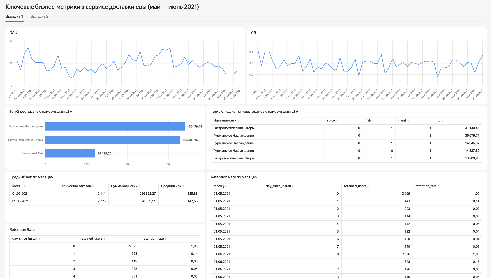
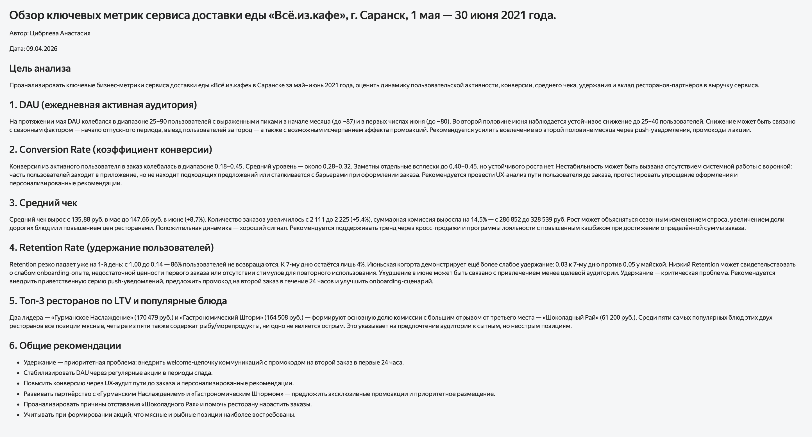

# Food delivery service: key business metrics dashboard

**Tool:** Yandex DataLens

**Dashboard language:** Russian

**Live dashboard:** [link](https://datalens.ru/4ah82rewci2wo-klyuchevye-biznes-metriki-v-servise-dostavki-edy-may-i)

## Goal
Analyze key business metrics of a food delivery service: user activity, 
conversion, average commission per order, retention, and partner
restaurants' contribution to revenue.

## What's inside
- **Metrics tab:** DAU, conversion rate, retention by cohort,
  top restaurants by LTV, top dishes
- **Conclusions tab:** findings and recommendations for each metric

## Key findings
- Retention is the main problem: 86% of users don't return
  on day 1, only ~4% remain by day 7
- Two restaurants brought about 170K and 165K in commission each,
  almost 3 times more than the third one (61K)
- Order count grew by 5.4% from May to June, total commission
  by 14.5%

